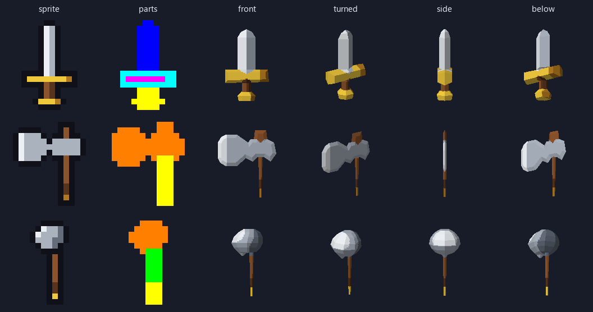
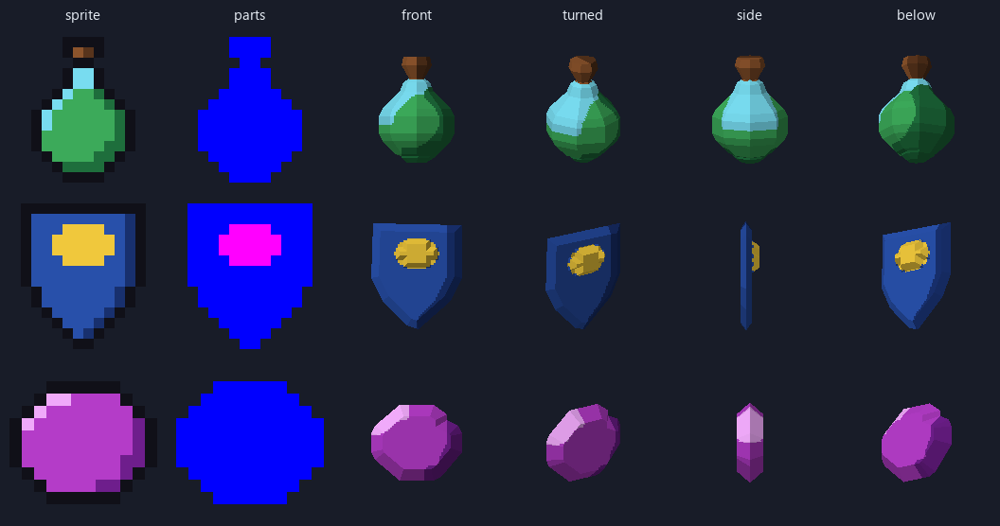
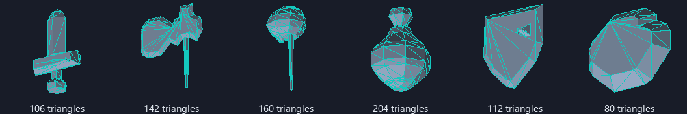
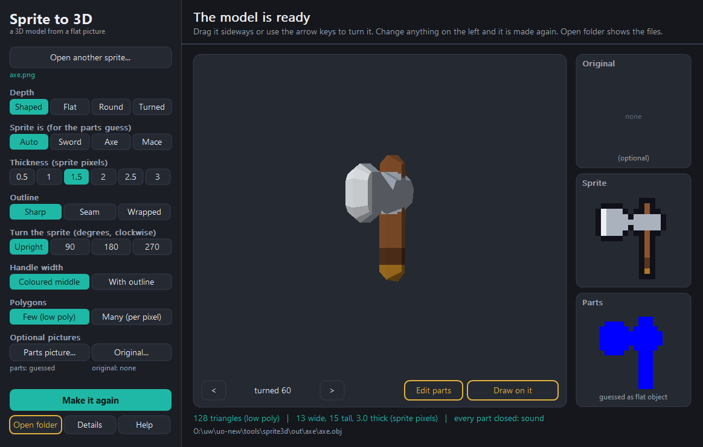

# Sprite2Maybe: a low-poly 3D model from a 2D pixel-art sprite

Takes one flat sprite (a PNG with a clear background) and makes a 3D model of it: by default a low-poly one (a sword
is about 100 triangles, a handle 20), split into labelled parts (blade, handle, guard, gem, body...), each built as a
simple shape (round bar, lathe, ball, blade, plate, box, dome, card) with its own depth, offset, taper and bevel. The
sprite's own pixels are the texture: no colour is blended or added. Every model is checked closed all round.

Status: a working tool, made for turning the 16x16 item sprites of an old dungeon game into 3D objects; it works on
any sprite. The tool's own name inside is still `sprite3d`. Windows (the window is plain Win32 C); the Python part runs
anywhere with numpy and Pillow. No game art is included. RESEARCH.md is the reading and the trials behind it; the
`work\...` folders it names are the author's trial folders and are not in this repository.

Each row above is one 16x16 sprite: the sprite itself, the parts it was split into (each colour one part), then the
model from the front, turned, from the side and from below. The sword and axe parts are the tool's own guess
(`--kind sword`, `--kind axe`); the potion and the gem were guessed with no help (a lathe and a dome). The shield and
the mace use the hand-made parts files in `examples/parts`: the shield is a plate with its boss as a dome standing out
of it, and the mace head is a ball.

Every model is a few dozen to a couple of hundred triangles; the colours come from the sprite laid on as a texture.

The window: the settings on the left, the model in the middle (drag it, or the arrows), the sprite and its parts on the
right.

The six example sprites are in `examples/` (drawn for this repository, free to use). To try one:

    python sprite3d.py examples/sword.png --kind sword
    python sprite3d.py examples/shield.png --parts examples/parts/shield_parts.png

Two ways to use it:

| Start | What it is |
| --- | --- |
| `sprite3d.exe` | **The window.** Open or drop a sprite; the model is made at once and again whenever you change a setting. Drag the model to turn it. `?` or F1 for help. |
| `python sprite3d.py SPRITE.png [switches]` | The command line. `python sprite3d.py` alone prints every switch. |

## The three ways to give a flat picture depth (`--method`)

- **shaped** (the default): by part. A blade becomes a ridge, a shaft or grip is round, an axe or mace head is a plate
  with a bevelled edge, a guard is a block, a gem is a dome. Which pixel is which part comes from a *parts picture*.
- **slab**: every pixel the same thickness, a plate. What Minecraft does with its item pictures.
- **round**: thicker the farther a pixel is from the outline, a pillow. The "inflation" method.

## A sprite drawn lying down (`--turn`)

`--turn 90|180|270` (the window: *Turn the sprite*) turns the sprite clockwise by that much before the model is made,
so a sprite drawn on its side or upside down is built tip up. A parts picture is turned the same way, so it is painted
over the sprite as it is in its file.

## Polygons (`--mesh lowpoly|pixels`; the window: *Polygons*)

**lowpoly (the default): very few polygons** (`lowpoly.py`). Each part is one simple closed shape and the colours
come from the texture, not the faces:

| Part | Shape | Triangles |
| --- | --- | --- |
| handle (shaft + grip) | a six-sided prism, one ring wherever the width changes, flat caps | 20 for a plain handle |
| blade | a diamond section (edge, ridge, edge, ridge) swept along the outline, a point at the tip | about 30 |
| head, guard, the rest | a plate from the traced, simplified outline: a sharp edge, a bevel, a flat face | 40 to 150 |

A whole weapon is about 100 to 200 triangles (it was 7,000 to 13,000). The texture is the sprite enlarged 4x by
cleanEdge (its own colours), laid on from the front and the back (planar UVs); turn texture smoothing off (nearest) in
a 3D program. Each part is closed on its own; parts touch, they are not welded.

**pixels**: a block of model for every pixel (and with `--detail` finer ones): thousands of faces.

## Detail (`--detail 1|2|4|8`; the window: *Detail*, with Many polygons)

At 1 the model has one block a sprite pixel (stair-steps on every slope). At 2, 4 or 8 every sprite pixel is made of
that many smaller ones across:

1. the outer dark outline is painted in the colour beside it;
2. the sprite is enlarged by **cleanEdge** (`cleanedge.py`, torcado's shader, MIT): slopes and curves come out
   smooth, and every pixel is still one of the sprite's own colours (nothing blended);
3. the depth comes from an **inflation** solve (Baran and Lehtinen's Poisson equation, solved by conjugate
   gradients): shafts and grips round, blades and axe heads lenses that thin to a sharp edge, guards a bar standing
   out a little, parts running into each other without a wall.

4x is the best value: about 7,000 to 10,000 faces and 2 to 3 seconds. 8x looks the same at four times the faces. The
enlarged picture is kept in the out folder (`enlarged_4x_*.png`) so the next run is quick, and it is the model's
texture.

## Blades thinner than the handle

As on a real weapon, a blade is at its thickest 60% of the handle's thickness and an axe or mace head 85%
(`BLADE_OF_HANDLE`, `HEAD_OF_HANDLE` in sprite3d.py), at every detail. The thickness setting is the most they may
have; the handle's own roundness sets the rest. Painting a pixel thicker can still go past it.

## Handle width (`--handle`)

With the Sharp outline, a shaft or grip is as wide as its **coloured** pixels (`inner`, the default): its dark outline
is left off the model, so the handle is as thin as it looks in the sprite. `full` keeps the outline in (thicker).

## Drawing thinner and thicker (`--paint`, the window's *Draw on it*)

A grey picture the same size as the sprite, painted over it: clear = as made, 128 = as made (and kept, even where the
handle outline would be left off), darker = thinner (64 half as thick), lighter = thicker (255 twice), black = the
pixel is cut away. In the window: press **Draw on it**, pick Thinner / Thicker / Cut away / Keep / As made and a brush
size, and paint with the left button (the right button undoes). The model is made again when you let go. The drawing
is saved as `out\NAME\NAME_paint.png`; a `NAME_paint.png` beside the sprite is read too. Navy pixels on the drawing
are the handle outline the model leaves off.

## Parts: what each piece of the sprite is (`--parts`, the window's *Edit parts*)

Any sprite is split into parts (`regions.py`). Each part has:

| Setting | What it does |
| --- | --- |
| label | what it is: Blade, Handle, Grip, Guard, Head, Gem, Pommel, Body, Lid, Neck, Base, Rim, Strap, Other. Picking a label sets its usual shape; a blade is kept thinner than a handle, a head too |
| shape | how it is built (below) |
| depth | its thickness, times the shape's own |
| toward you / away | the part moved forward or back, sprite pixels (a gem standing out of a shield) |
| thins toward | none, up, down, left or right, and how much (0 none, 1 down to nothing): a wedge, a tapering blade |
| bevel | the sloping rim of a plate or dome, sprite pixels |
| sides | the sides round a round bar, lathe or ball |

| Shape | Built as | For |
| --- | --- | --- |
| Round bar | a prism of so many sides | handles, shafts, poles, legs |
| Lathe | every row a circle as wide as the row | bottles, candles, goblets, lanterns, wands |
| Ball | a lathe that follows the outline closely | pommels, orbs, fruit |
| Blade | a diamond section swept along the outline | blades, spear heads |
| Plate | a sharp edge, a bevel, a flat face | axe heads, shields, books, armour, coins |
| Box | a flat slab with straight sides | guards, planks, chests seen face on |
| Dome | rings rising from the edge to a top | gems, buttons, bread, rocks, sacks |
| Card | hardly any thickness | paper, maps, cloth, stains |

**The guess** (`--kind auto`): a long sprite with a narrow handle at its foot is a weapon (blade, handle, grip,
guard, head, gem); anything else is one part chosen by its outline: tall and mirror-symmetric = Lathe, round and full
= Dome, square and full = Plate, the rest = Plate. Every one of the 461 item sprites builds a sound low-poly model
this way (20 to 554 triangles, median 140; `work\fine\all_sprites.py`).

**The files**: `NAME_parts.png` (each pixel its part's colour) and `NAME_parts.txt` beside it (one JSON line a part:
colour, label, shape, depth, offset, taper, taper_amount, bevel, sides). The guess is written to the out folder to start
from; the window keeps your own as `out\NAME\NAME_myparts.png` + `.txt`. A parts picture in the six old colours
(blade 0,0,255; shaft 0,255,0; grip 255,255,0; guard 0,255,255; head 255,128,0; gem 255,0,255) with no .txt is still
read. A sprite pixel the picture leaves unpainted takes the nearest painted pixel's part.

**In the window**: *Edit parts* shows the sprite in its parts' colours. Paint pixels into the chosen part with the left
button, pick a part with the right; choose its label and shape and step its settings on the right; New part, Delete
part, Guess again. The model is made again after every change.

## What comes out (in `out\NAME\` beside the tool, or `--out`)

- `NAME.obj`, `NAME.mtl`, `NAME_tex.png`: the model. One unit is a sprite pixel, y is up, the grip is at the bottom.
  In a 3D program turn texture smoothing off (nearest) so the pixels stay sharp.
- `NAME_parts.png`: the parts used (shaped only).
- `NAME_sheet.png`: the original (if given with `--original`), the sprite, the parts and the model from every side.

## Building the window

`gui\build.cmd` (clang with the MinGW headers; nothing else). It is plain C on Win32 and GDI+, made the way the base
kit's window is: it starts `sprite3d.py --json` hidden and reads one JSON record a line.
`sprite3d.exe --selftest SHOT.bmp SPRITE.png` runs it off screen and writes the window's picture and a `.txt` of what
happened.

Python needs numpy and Pillow. The window looks for Python in `SPRITE3D_PYTHON`, then
`O:\appsnotonc\pixelup\.venv\Scripts\python.exe`, then on the PATH.
